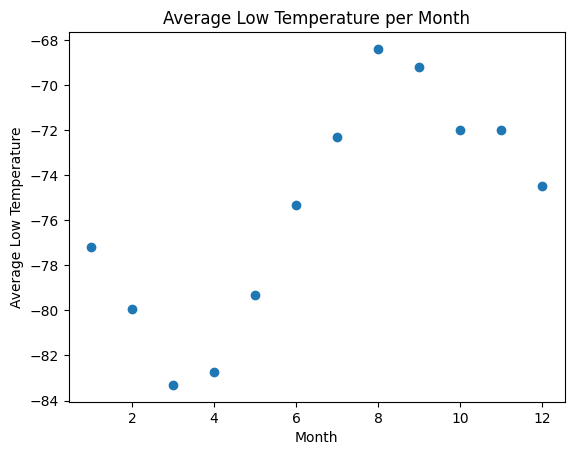
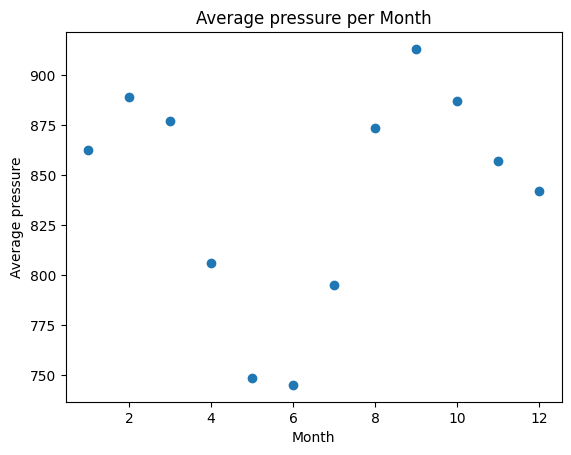

# Mars weather through Curiosity’s eyes

How much does a cold night on Mars change with the seasons? At the Curiosity rover’s location, the average daily low in the warmest month was about **15°C warmer** than in the coldest. This 2023 web-scraping project follows the evidence from a web page to **1,867 distinct Martian days** of weather observations.

## A year of Martian weather

Each dot is the average of the daily **low** temperatures recorded for that Martian month across the dataset. Month 3 had the coldest average low (**−83.3°C**). By month 8 it had risen to **−68.4°C**. The month numbers follow Mars’s seasons, so month 3 doesn’t mean March on Earth.

Air pressure followed a different rhythm. It reached its lowest monthly average in **month 6** and its highest in **month 9**. Both charts are original outputs from the weather notebook.

[Explore the weather analysis](Starter_Code/part_2_mars_weather.ipynb) · [View the weather observations as a spreadsheet](Starter_Code/marsweather.csv)

## Collecting the news

The other half of the project turned a Mars news page into **15 headline-and-summary pairs** in the saved run. One story described NASA’s MAVEN spacecraft observing two kinds of aurora during a solar storm. Keeping each headline beside its summary means a reader can scan the stories without opening them one by one.

The Python script opened the page in a browser, found each article by its HTML class, and collected the headline and preview from the same article. The weather notebook used a similar approach to collect table rows, then grouped the readings by month to produce the charts above.

[See the extracted headlines and summaries](Starter_Code/part_1_mars_news.ipynb)
